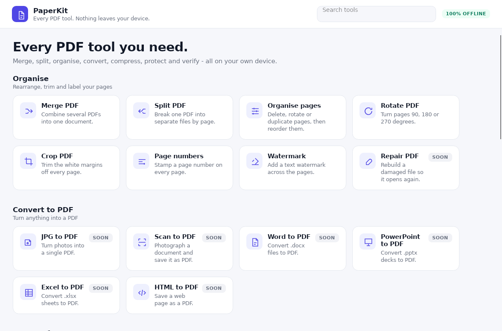
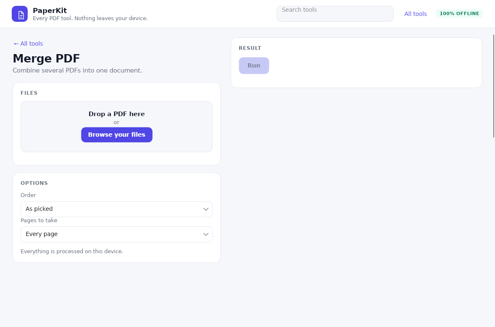

<div align="center">

# PaperKit

**Every PDF tool you need — completely offline.**
Windows + Android. Nothing ever leaves your device.

[](https://github.com/YOUR_USERNAME/PaperKit/actions/workflows/build.yml)
[](LICENSE)


</div>

---

## What PaperKit is

A **toolbox of PDF tools in one small app** — the same set as iLovePDF, but every
file is processed **on your own device**. No upload, no cloud, no account, no
tracking, no internet connection required.

* **Windows 10/11 (64-bit)** — a real native desktop app (no web view, no browser engine).
* **Android 6.0+** — a real native app, **no internet permission at all**.

Both apps come from **one** C# code base with [Avalonia UI](https://avaloniaui.net)
and [PDFsharp](https://www.pdfsharp.net): the same window, the same tools, the
same PDF engine — two thin platform heads.



## The tools

| Group | Tools |
|---|---|
| **Organise** | Merge · Split · Organise pages · Rotate · Crop · Page numbers · Watermark · Repair |
| **Convert to PDF** | JPG to PDF · Scan to PDF · Word to PDF · PowerPoint to PDF · Excel to PDF · HTML to PDF |
| **Convert from PDF** | PDF to JPG · PDF to Word · PDF to PowerPoint · PDF to Excel · PDF to Markdown |
| **Optimise** | Compress · OCR · PDF to PDF/A · Edit PDF · Compare PDF |
| **Secure** | Protect · Unlock · Redact · Sign · Fill forms |
| **Verify** | Verify digital signature (with the 7 official CCA India roots) |

**Ready today:** Merge, Split, Organise pages, Rotate, Crop, Page numbers and
Watermark. The rest are on the roadmap and are marked *soon* in the app, so you
always know what actually works.



> AI Summarizer and Translate PDF are intentionally **not** included — they would
> need a model on the device, which would break the "light and fully offline"
> promise.

## Download

Go to **Releases** on the right of this page and pick your platform:

| Platform | File | Install |
|---|---|---|
| **Windows 10/11 (64-bit)** | `PaperKit-windows-x64.zip` | extract it, run `PaperKit.exe` |
| **Android 6.0+** | `PaperKit-android.apk` | copy it to the phone, tap to install |

## Why it's built this way

| | |
|---|---|
| 🧩 **One codebase** | the Windows app and the Android app are the same Avalonia UI and the same PDF engine |
| 🚫 **No web view** | no Electron, no Chromium, no Capacitor — the UI is real native widgets |
| 🌐 **No network** | no uploads, no cloud, no accounts, no telemetry |
| 🪶 **Light** | the Android app asks for **no permissions at all**, not even the internet |
| 🔒 **7 CCA India roots** | bundled, so Indian government PDFs validate properly |
| 📄 **Verification report** | export the verdict + chain + fingerprints as PDF or JSON |

The signature verifier exists because Adobe Acrobat shows a yellow **"?"** on
Indian government documents — Aadhaar, e-District certificates, DigiLocker PDFs —
since Adobe's trust list has no **CCA India** root. PaperKit bundles those seven
official roots from <https://cca.gov.in/root_certificate.html>, so those
documents validate properly, still without an internet connection.

| Verdict | Meaning |
|---|---|
| **Signature valid** | Content is unchanged since signing, and the signer chains to a root this app trusts. |
| **Signature valid, with later changes** | Signed content intact, but something was appended after signing. |
| **Intact, but issuer not trusted** | Not tampered with — but the certificate does not chain to a root this app trusts. This is what Acrobat's yellow "?" means. |
| **Document modified after signing** | The content no longer matches the digest recorded at signing time. |
| **No digital signature** | Nothing to verify. |

## Layout

```
native/
  PaperKit.Core/     the engine - PDFsharp 6, the tool catalogue, the trust store
  PaperKit.App/      the shared view models (plain C#, no UI framework)
  PaperKit.Ui/       the XAML - one window, shared by both platforms
  PaperKit.Windows/  the Windows head   -> PaperKit.exe
  PaperKit.Android/  the Android head   -> PaperKit.apk
  PaperKit.Shot/     renders the real window to a PNG (screenshots / visual check)
  PaperKit.Spec/     the test suite (xUnit, 16 tests against real PDFs)
trust-roots/          the real CCA India root certificates
fixtures/             real signed PDFs used by the tests
tools/                build, packaging and publishing scripts
```

Both platform heads compile **the same** `PaperKit.Ui` window and share the
`PaperKit.Core` engine — there is no duplicated UI code.

## Build it

```bash
# 1. everything the build needs (once)
bash tools/setup_native_build.sh

# 2. run the tests
dotnet test native/PaperKit.Spec/PaperKit.Spec.csproj

# 3. Windows (self contained - no .NET install needed on the PC)
dotnet publish native/PaperKit.Windows/PaperKit.Windows.csproj \
  -c Release -r win-x64 --self-contained true -o out/win

# 4. Android
dotnet publish native/PaperKit.Android/PaperKit.Android.csproj \
  -c Release -f net8.0-android -o out/android
```

`bash tools/build_native.sh` does steps 2 to 4 and drops both apps into
`deliverables/`.

Push a tag and GitHub Actions builds both and publishes them to one release:

```bash
git tag v1.0.0 && git push origin v1.0.0
```

## Trust anchors

The app ships with the seven **CCA India** root certificates downloaded from
<https://cca.gov.in/root_certificate.html>. These are the roots that every
Aadhaar, e-District certificate, DigiLocker document and Form 16 chains up
to — and the reason Adobe shows a yellow "?".

They are embedded in the app (`PaperKit.Core`), so they are available on the
very first start, on every device, with no network.

## Roadmap

Done: the native Windows app, the native Android app and the seven page tools.
Next: the conversion and security tools, each one offline-first, and the
signature verifier in C#.

See `PLAN.md` for the full roadmap and the iLovePDF tool inventory.

## License

MIT — see [LICENSE](LICENSE).
